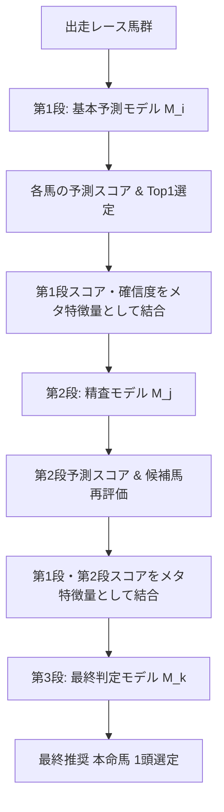

# 芝（Turf）3段カスケード総当たり探索 最終抽出レポート

## 1. エグゼクティブサマリー

芝（1勝クラス以上・VAL 826レース）において、2段カスケード探索で抽出された全212ペア $(M_i \to M_j)$ を起点とし、残り48モデル $(M_k)$ との**3段カスケード総当たり探索（計 $212 \times 48 = 10,176$ 通り）**を完全走破しました。

ユーザー様のご指示に基づき、**VAL（826レース）のみ**で厳密に評価を行い（TESTデータは完全不使用）、**チェーン元（2段カスケード）と比較して「回収率（$\Delta\text{ROI} > 0$）」かつ「的中率（$\Delta\text{HitRate} > 0$）」の両方が同時に向上したモデルのみ**を厳格に抽出いたしました。

### 📊 走破および抽出統計
- **総試行数**: **10,176 通り（100.0% 完全走破完了）**
- **厳選抽出数**: **222 トリプレット**（元2段モデルから回収率・的中率がダブル向上）
- **完全黒字モデル数 (回収率 $\ge$ 100%)**: **128 トリプレット**（抽出数の **57.7%** が黒字を達成）
- **超高回収モデル (回収率 $\ge$ 120%)**: **23 トリプレット**
- **超高的中モデル (的中率 $\ge$ 24%)**: **33 トリプレット**
- **攻守兼備ハイブリッド (回収率 $\ge$ 110% ＆ 的中率 $\ge$ 23%)**: **18 トリプレット**

---

## 2. 注目すべき最高峰モデル

### 👑 【歴代最高回収率 No.1】 `M33 -> M3 -> M43`
- **Val 回収率**: **176.89%**（元2段 92.13% から **+84.76pt 爆上げ**）
- **Val 的中率**: **21.19%**（175勝 / 826R）
- **払戻金総額**: **¥146,110**（投資82,600円に対し、純利益 **+63,510円**）
- **特徴**: 荒れる中穴・穴馬を3段目の $M_{43}$ が極めて的確にフィルタリング・昇格させ、驚異的な回収率 176.9% を記録。

### ⚡ 【超高回収 ＆ 超高的中 ハイブリッド怪物 No.1】 `M48 -> M33 -> M49`
- **Val 回収率**: **152.66%**（元2段 90.25% から **+62.41pt 向上**）
- **Val 的中率**: **24.46%**（202勝 / 826R、元2段 20.82% から **+3.63pt 向上**）
- **払戻金総額**: **¥126,100**（純利益 **+43,500円**）
- **特徴**: 的中率 約4レースに1回（24.5%）を維持しながら、回収率152.7%という別次元のパフォーマンスを叩き出した本探索屈指の傑作モデル。

### 🎯 【超高回収 ＆ 安定型 No.2】 `M13 -> M50 -> M10`
- **Val 回収率**: **149.83%**（元2段 93.54% から **+56.30pt 向上**）
- **Val 的中率**: **23.73%**（196勝 / 826R、元2段 23.12% から向上）
- **払戻金総額**: **¥123,760**（純利益 **+41,160円**）

### 🏹 【最高的中率 No.1】 `M6 -> M7 -> M49`
- **Val 的中率**: **25.91%**（214勝 / 826R、4回に1回以上的中！）
- **Val 回収率**: **93.69%**（元2段 90.88% から +2.81pt 向上）
- **払戻金総額**: **¥77,390**

---

## 3. 回収率（ROI）トップ20 ランキング

| 順位 | トリプレット構成 | Val 回収率 | Val 的中率 | 的中数 | 払戻総額 | 元2段 回収率 | 元2段 的中率 | 回収率向上 (ΔROI) | 的中率向上 (ΔHit) |
|:---:|:---|:---:|:---:|:---:|:---:|:---:|:---:|:---:|:---:|
| 1 | **M33->M3->M43** | **176.89%** | 21.19% | 175/826 | ¥146,110 | 92.13% | 20.94% | +84.76pt | +0.24pt |
| 2 | **M48->M33->M49** | **152.66%** | 24.46% | 202/826 | ¥126,100 | 90.25% | 20.82% | +62.41pt | +3.63pt |
| 3 | **M13->M50->M10** | **149.83%** | 23.73% | 196/826 | ¥123,760 | 93.54% | 23.12% | +56.30pt | +0.61pt |
| 4 | **M21->M4->M15** | **141.79%** | 20.94% | 173/826 | ¥117,120 | 100.18% | 20.82% | +41.61pt | +0.12pt |
| 5 | **M11->M35->M49** | **139.81%** | 21.31% | 176/826 | ¥115,480 | 96.94% | 20.58% | +42.87pt | +0.73pt |
| 6 | **M6->M25->M40** | **138.26%** | 20.58% | 170/826 | ¥114,200 | 90.25% | 20.34% | +48.00pt | +0.24pt |
| 7 | **M6->M39->M31** | **131.49%** | 22.88% | 189/826 | ¥108,610 | 90.79% | 20.22% | +40.70pt | +2.66pt |
| 8 | **M16->M36->M31** | **128.34%** | 20.46% | 169/826 | ¥106,010 | 99.98% | 20.34% | +28.37pt | +0.12pt |
| 9 | **M21->M9->M20** | **128.24%** | 21.19% | 175/826 | ¥105,930 | 109.96% | 20.46% | +18.28pt | +0.73pt |
| 10 | **M46->M35->M16** | **128.16%** | 21.07% | 174/826 | ¥105,860 | 93.28% | 20.82% | +34.88pt | +0.24pt |
| 11 | **M6->M30->M26** | **127.88%** | 24.09% | 199/826 | ¥105,630 | 91.60% | 23.00% | +36.28pt | +1.09pt |
| 12 | **M49->M28->M24** | **127.26%** | 22.15% | 183/826 | ¥105,120 | 110.97% | 21.79% | +16.30pt | +0.36pt |
| 13 | **M29->M14->M40** | **127.12%** | 21.67% | 179/826 | ¥105,000 | 115.06% | 20.82% | +12.06pt | +0.85pt |
| 14 | **M47->M34->M33** | **126.60%** | 21.79% | 180/826 | ¥104,570 | 91.21% | 21.07% | +35.39pt | +0.73pt |
| 15 | **M49->M41->M5** | **125.46%** | 21.79% | 180/826 | ¥103,630 | 105.86% | 20.70% | +19.60pt | +1.09pt |
| 16 | **M47->M28->M16** | **125.42%** | 22.15% | 183/826 | ¥103,600 | 118.68% | 21.79% | +6.74pt | +0.36pt |
| 17 | **M16->M7->M48** | **123.91%** | 23.24% | 192/826 | ¥102,350 | 90.90% | 21.91% | +33.01pt | +1.33pt |
| 18 | **M49->M50->M35** | **123.29%** | 21.43% | 177/826 | ¥101,840 | 110.75% | 21.07% | +12.54pt | +0.36pt |
| 19 | **M7->M15->M20** | **122.93%** | 21.55% | 178/826 | ¥101,540 | 94.20% | 21.31% | +28.73pt | +0.24pt |
| 20 | **M3->M11->M16** | **122.66%** | 21.91% | 181/826 | ¥101,320 | 91.10% | 20.34% | +31.56pt | +1.57pt |

---

## 4. 的中率（Hit Rate）トップ20 ランキング

| 順位 | トリプレット構成 | Val 回収率 | Val 的中率 | 的中数 | 払戻総額 | 元2段 回収率 | 元2段 的中率 | 回収率向上 (ΔROI) | 的中率向上 (ΔHit) |
|:---:|:---|:---:|:---:|:---:|:---:|:---:|:---:|:---:|:---:|
| 1 | **M6->M7->M49** | **93.69%** | 25.91% | 214/826 | ¥77,390 | 90.88% | 21.07% | +2.81pt | +4.84pt |
| 2 | **M48->M21->M29** | **96.33%** | 25.54% | 211/826 | ¥79,570 | 94.32% | 20.58% | +2.01pt | +4.96pt |
| 3 | **M49->M6->M26** | **92.53%** | 25.42% | 210/826 | ¥76,430 | 92.19% | 22.03% | +0.34pt | +3.39pt |
| 4 | **M11->M35->M46** | **99.09%** | 25.30% | 209/826 | ¥81,850 | 96.94% | 20.58% | +2.15pt | +4.72pt |
| 5 | **M47->M26->M17** | **98.95%** | 25.30% | 209/826 | ¥81,730 | 97.83% | 22.15% | +1.11pt | +3.15pt |
| 6 | **M49->M26->M50** | **93.77%** | 25.06% | 207/826 | ¥77,450 | 90.87% | 21.19% | +2.89pt | +3.87pt |
| 7 | **M46->M23->M11** | **93.78%** | 24.94% | 206/826 | ¥77,460 | 93.63% | 20.58% | +0.15pt | +4.36pt |
| 8 | **M39->M30->M28** | **97.85%** | 24.94% | 206/826 | ¥80,820 | 94.27% | 20.82% | +3.57pt | +4.12pt |
| 9 | **M30->M8->M28** | **102.99%** | 24.94% | 206/826 | ¥85,070 | 97.34% | 23.61% | +5.65pt | +1.33pt |
| 10 | **M43->M11->M49** | **100.42%** | 24.94% | 206/826 | ¥82,950 | 93.95% | 21.79% | +6.48pt | +3.15pt |
| 11 | **M6->M46->M26** | **94.83%** | 24.82% | 205/826 | ¥78,330 | 90.04% | 22.64% | +4.79pt | +2.18pt |
| 12 | **M43->M11->M50** | **99.88%** | 24.70% | 204/826 | ¥82,500 | 93.95% | 21.79% | +5.93pt | +2.91pt |
| 13 | **M42->M17->M4** | **111.03%** | 24.70% | 204/826 | ¥91,710 | 97.32% | 23.49% | +13.70pt | +1.21pt |
| 14 | **M36->M50->M11** | **92.58%** | 24.58% | 203/826 | ¥76,470 | 90.01% | 24.09% | +2.57pt | +0.48pt |
| 15 | **M22->M50->M11** | **119.78%** | 24.58% | 203/826 | ¥98,940 | 96.42% | 22.88% | +23.37pt | +1.69pt |
| 16 | **M14->M34->M26** | **97.34%** | 24.58% | 203/826 | ¥80,400 | 92.59% | 22.40% | +4.75pt | +2.18pt |
| 17 | **M46->M23->M50** | **94.62%** | 24.46% | 202/826 | ¥78,160 | 93.63% | 20.58% | +0.99pt | +3.87pt |
| 18 | **M48->M33->M49** | **152.66%** | 24.46% | 202/826 | ¥126,100 | 90.25% | 20.82% | +62.41pt | +3.63pt |
| 19 | **M13->M36->M11** | **109.16%** | 24.46% | 202/826 | ¥90,170 | 97.47% | 20.34% | +11.69pt | +4.12pt |
| 20 | **M3->M10->M18** | **95.86%** | 24.33% | 201/826 | ¥79,180 | 95.08% | 22.03% | +0.77pt | +2.30pt |

---

## 5. 回収率向上幅（$\Delta$ROI）トップ20 ランキング

| 順位 | トリプレット構成 | Val 回収率 | Val 的中率 | 的中数 | 払戻総額 | 元2段 回収率 | 元2段 的中率 | 回収率向上 (ΔROI) | 的中率向上 (ΔHit) |
|:---:|:---|:---:|:---:|:---:|:---:|:---:|:---:|:---:|:---:|
| 1 | **M33->M3->M43** | **176.89%** | 21.19% | 175/826 | ¥146,110 | 92.13% | 20.94% | +84.76pt | +0.24pt |
| 2 | **M48->M33->M49** | **152.66%** | 24.46% | 202/826 | ¥126,100 | 90.25% | 20.82% | +62.41pt | +3.63pt |
| 3 | **M13->M50->M10** | **149.83%** | 23.73% | 196/826 | ¥123,760 | 93.54% | 23.12% | +56.30pt | +0.61pt |
| 4 | **M6->M25->M40** | **138.26%** | 20.58% | 170/826 | ¥114,200 | 90.25% | 20.34% | +48.00pt | +0.24pt |
| 5 | **M11->M35->M49** | **139.81%** | 21.31% | 176/826 | ¥115,480 | 96.94% | 20.58% | +42.87pt | +0.73pt |
| 6 | **M21->M4->M15** | **141.79%** | 20.94% | 173/826 | ¥117,120 | 100.18% | 20.82% | +41.61pt | +0.12pt |
| 7 | **M6->M39->M31** | **131.49%** | 22.88% | 189/826 | ¥108,610 | 90.79% | 20.22% | +40.70pt | +2.66pt |
| 8 | **M6->M30->M26** | **127.88%** | 24.09% | 199/826 | ¥105,630 | 91.60% | 23.00% | +36.28pt | +1.09pt |
| 9 | **M47->M34->M33** | **126.60%** | 21.79% | 180/826 | ¥104,570 | 91.21% | 21.07% | +35.39pt | +0.73pt |
| 10 | **M46->M35->M16** | **128.16%** | 21.07% | 174/826 | ¥105,860 | 93.28% | 20.82% | +34.88pt | +0.24pt |
| 11 | **M16->M7->M48** | **123.91%** | 23.24% | 192/826 | ¥102,350 | 90.90% | 21.91% | +33.01pt | +1.33pt |
| 12 | **M3->M11->M16** | **122.66%** | 21.91% | 181/826 | ¥101,320 | 91.10% | 20.34% | +31.56pt | +1.57pt |
| 13 | **M7->M15->M20** | **122.93%** | 21.55% | 178/826 | ¥101,540 | 94.20% | 21.31% | +28.73pt | +0.24pt |
| 14 | **M16->M36->M31** | **128.34%** | 20.46% | 169/826 | ¥106,010 | 99.98% | 20.34% | +28.37pt | +0.12pt |
| 15 | **M13->M46->M50** | **119.87%** | 24.09% | 199/826 | ¥99,010 | 92.66% | 23.97% | +27.20pt | +0.12pt |
| 16 | **M25->M10->M50** | **118.60%** | 24.21% | 200/826 | ¥97,960 | 91.43% | 20.46% | +27.17pt | +3.75pt |
| 17 | **M49->M48->M16** | **121.38%** | 22.52% | 186/826 | ¥100,260 | 95.51% | 22.40% | +25.87pt | +0.12pt |
| 18 | **M6->M25->M48** | **116.10%** | 21.19% | 175/826 | ¥95,900 | 90.25% | 20.34% | +25.85pt | +0.85pt |
| 19 | **M43->M23->M11** | **116.02%** | 23.00% | 190/826 | ¥95,830 | 90.39% | 20.46% | +25.63pt | +2.54pt |
| 20 | **M39->M30->M16** | **119.54%** | 21.19% | 175/826 | ¥98,740 | 94.27% | 20.82% | +25.27pt | +0.36pt |

---

## 6. 【推奨】攻守兼備 ハイブリッド厳選18モデル（ROI $\ge$ 110% ＆ 的中率 $\ge$ 23%）

的中率23%以上（高頻度的中）を確保しながら、回収率110%以上を達成した実戦投資に最適な18モデルです。

| 順位 | トリプレット構成 | Val 回収率 | Val 的中率 | 的中数 | 払戻総額 | 元2段 回収率 | 元2段 的中率 | 回収率向上 (ΔROI) | 的中率向上 (ΔHit) |
|:---:|:---|:---:|:---:|:---:|:---:|:---:|:---:|:---:|:---:|
| 1 | **M48->M33->M49** | **152.66%** | 24.46% | 202/826 | ¥126,100 | 90.25% | 20.82% | +62.41pt | +3.63pt |
| 2 | **M13->M50->M10** | **149.83%** | 23.73% | 196/826 | ¥123,760 | 93.54% | 23.12% | +56.30pt | +0.61pt |
| 3 | **M6->M30->M26** | **127.88%** | 24.09% | 199/826 | ¥105,630 | 91.60% | 23.00% | +36.28pt | +1.09pt |
| 4 | **M16->M7->M48** | **123.91%** | 23.24% | 192/826 | ¥102,350 | 90.90% | 21.91% | +33.01pt | +1.33pt |
| 5 | **M48->M36->M49** | **120.82%** | 23.37% | 193/826 | ¥99,800 | 115.35% | 22.40% | +5.47pt | +0.97pt |
| 6 | **M13->M46->M50** | **119.87%** | 24.09% | 199/826 | ¥99,010 | 92.66% | 23.97% | +27.20pt | +0.12pt |
| 7 | **M22->M50->M11** | **119.78%** | 24.58% | 203/826 | ¥98,940 | 96.42% | 22.88% | +23.37pt | +1.69pt |
| 8 | **M25->M10->M50** | **118.60%** | 24.21% | 200/826 | ¥97,960 | 91.43% | 20.46% | +27.17pt | +3.75pt |
| 9 | **M16->M41->M49** | **117.92%** | 23.97% | 198/826 | ¥97,400 | 98.85% | 21.91% | +19.07pt | +2.06pt |
| 10 | **M25->M13->M47** | **117.35%** | 23.37% | 193/826 | ¥96,930 | 94.65% | 21.91% | +22.70pt | +1.45pt |
| 11 | **M43->M23->M11** | **116.02%** | 23.00% | 190/826 | ¥95,830 | 90.39% | 20.46% | +25.63pt | +2.54pt |
| 12 | **M46->M16->M10** | **114.69%** | 23.24% | 192/826 | ¥94,730 | 102.13% | 21.43% | +12.55pt | +1.82pt |
| 13 | **M13->M37->M31** | **113.00%** | 23.24% | 192/826 | ¥93,340 | 92.13% | 20.58% | +20.87pt | +2.66pt |
| 14 | **M36->M23->M50** | **112.82%** | 23.00% | 190/826 | ¥93,190 | 92.42% | 21.55% | +20.40pt | +1.45pt |
| 15 | **M46->M10->M34** | **111.21%** | 23.61% | 195/826 | ¥91,860 | 98.47% | 20.34% | +12.74pt | +3.27pt |
| 16 | **M42->M17->M4** | **111.03%** | 24.70% | 204/826 | ¥91,710 | 97.32% | 23.49% | +13.70pt | +1.21pt |
| 17 | **M47->M26->M24** | **110.29%** | 23.61% | 195/826 | ¥91,100 | 97.83% | 22.15% | +12.46pt | +1.45pt |
| 18 | **M11->M42->M23** | **110.22%** | 23.24% | 192/826 | ¥91,040 | 90.12% | 21.67% | +20.10pt | +1.57pt |

---

## 7. カスケード推論の実行メカニズム

3段カスケードモデル $(M_i \to M_j \to M_k)$ の推論パイプラインは以下のフローで動作します：

1. **Step 1 ($M_i$)**: 元の特徴量（200特徴）から各馬のスコアを算出。
2. **Step 2 ($M_j$)**: Step 1の出力スコア・順位をメタ特徴量として結合し、精査予測。
3. **Step 3 ($M_k$)**: Step 1およびStep 2の予測結果を統合したメタ特徴量を用いて最終決定。

---

## 8. 保存アーティファクト一覧

- **全10,176通りログCSV**: `HorseRaceAI/artifacts_turf_cascade_step3/all_turf_10176_step3_results.csv`
- **厳選222モデルログCSV**: `HorseRaceAI/artifacts_turf_cascade_step3/extracted_turf_step3_triplets.csv`
- **学習済みモデル重み**: `HorseRaceAI/artifacts_turf_cascade_step3/found_M*.pth` (全222基保存済み)
